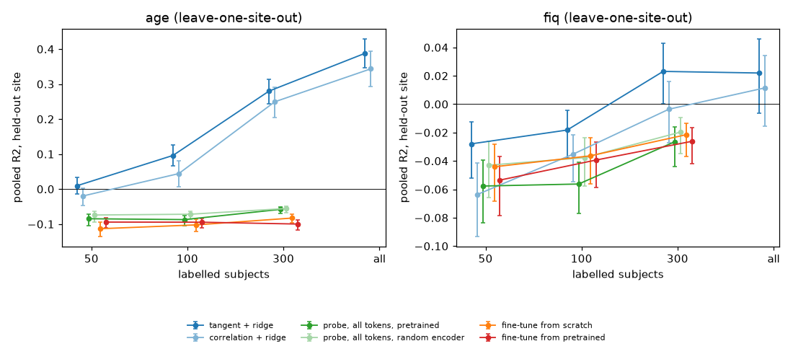
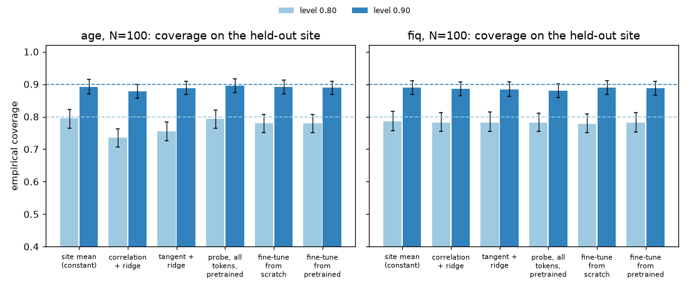
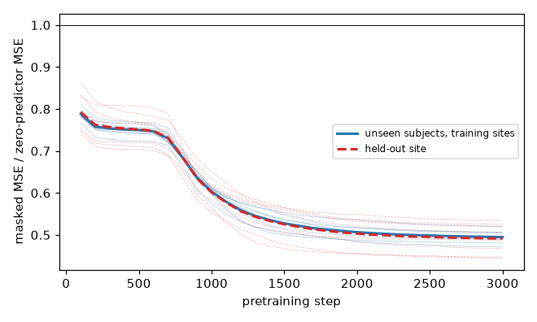

# connectome-pretrain

Does masked-modelling pretraining on resting-state ROI time series help predict age and full-scale IQ (FIQ) from few labelled subjects, compared with tangent-space connectivity plus ridge, and does the result survive a shift to a site that was never seen?

Data: ABIDE I preprocessed series (C-PAC, CC200 atlas, 200 ROIs), 787 subjects in 18 sites after quality checks. Protocol: leave-one-site-out over the eight sites with at least 40 subjects, 50, 100, 300 and all labelled subjects, five seeds, bootstrap intervals over subjects, split conformal intervals. A 1.03M-parameter transformer over ROI tokens is pretrained by masked reconstruction on the training sites only, then probed and fine-tuned. The baselines ran on Colab CPU, the neural arms on one Colab T4; the repository holds the code, the tests (synthetic series only) and every number below in `results/`.

## Results

8 held-out sites, 564 held-out subjects, five seeds, 1000 bootstrap replicates. R2 values below are pooled over all held-out subjects with 95 percent intervals in brackets.

Status of the neural results: the numbers below come from the first protocol (commit `cf8c9c8`). Two problems found afterwards are fixed in the code but not in the committed numbers, because the neural runs need a GPU and have not been repeated. The conformal intervals of the fine-tunes were calibrated on subjects that had also chosen the learning rates (24 to 46 of the 100 calibration subjects per run, `results/calibration_overlap.json`), and the transductive encoder was fine-tuned with the learning rate chosen for the inductive one. The affected cells are marked where they appear and listed in Limits. The baselines, the probes and the point metrics of the inductive fine-tunes are not affected.

- **Age, leave-one-site-out: ridge on connectivity is the only family with signal, tangent space ahead of correlations.** Pooled R2 0.10 [0.07, 0.13] with 100 labelled subjects and 0.39 [0.35, 0.43] with every training label, against -0.06 [-0.08, -0.06] for the constant predictor at N=100. Vectorised correlations need more labels for the same score (0.25 [0.20, 0.29] against 0.28 [0.24, 0.31] at N=300; tangent minus correlation at N=100 0.05 [0.03, 0.08]) and the RBF kernel is slightly worse than the linear one (-0.04 [-0.05, -0.04] at N=300). The mean age of the held-out site, which uses test labels and is not a model, scores 0.29 [0.21, 0.35]: a sizeable share of the age variance lies between sites.
- **Masked pretraining does not give a usable predictor at the preset budgets (150 to 300 fine-tuning steps).** At 300 labelled subjects the pretrained all-token probe has pooled R2 -0.06 [-0.07, -0.05] and its random-encoder control -0.06 [-0.07, -0.05]; fine-tuning from the pretrained encoder gives -0.10 [-0.12, -0.09] against -0.08 [-0.10, -0.07] from random weights, and the constant predictor scores -0.05 [-0.06, -0.05]. The pretrained start is a little better than random weights with 50 labels (pooled R2 difference 0.02 [0.01, 0.03], lower error on 6 of 8 sites) and a little worse with 300 (-0.02 [-0.02, -0.01]); the pretrained mean-token probe beats its random-encoder control by 0.03 [0.01, 0.05] at N=50 and by 0.00 [-0.00, 0.00] at N=300. Every neural arm stays at or below the constant predictor at every label count. The fine-tune learning rates were chosen once per fold, not inside each run as the ridge penalties are; Limits says in which direction that tilts the comparison with the baselines.
- **Seeing the held-out site's series did not help, at the learning rate of the inductive start.** The transductive encoder (pretrained on every subject, labels unused) fine-tuned with the rate chosen for the inductive encoder does worse than the inductive one (-0.10 [-0.11, -0.08] at N=50, -0.04 [-0.04, -0.03] at N=300, pooled R2). No rate was chosen for the transductive start itself, so a start that needs another rate may be understated; the tuned comparison (`ft_trans`) is implemented and has not been run. Its probes, whose ridge penalty is chosen on the labelled subjects like every other probe, are not better than the inductive probes.
- **A longer fine-tune does not help, it hurts.** With 300 labels and 1000 steps at one fixed rate of 3e-4 for both starts (not tuned for either) on 8 held-out sites (MAX_MUN, NYU, PITT, TRINITY, UCLA_1, UM_1, USM, YALE), pooled R2 is -0.26 [-0.31, -0.23] from random weights and -0.38 [-0.44, -0.33] from the transductive encoder, below the 300-step runs (-0.08 [-0.10, -0.07] and -0.14 [-0.16, -0.12]) and below the constant predictor (-0.05 [-0.06, -0.05]); tangent + ridge scores 0.28 [0.24, 0.31] on the same sites. At that rate the pretrained start is worse than random weights (mean absolute error, transductive minus scratch, 0.33 [0.25, 0.41] years; lower error on 3 of 8 sites). A one-site check on NYU, where the transductive start looked better after 1500 steps, did not carry over to the other sites.
- **FIQ is not predicted by any arm.** The best pooled R2 is 0.02 [-0.01, 0.05] (tangent + ridge, every label), an interval that includes zero; the constant predictor scores -0.02 [-0.03, -0.01] and the neural arms are below zero (fine-tune from pretrained at N=300: -0.03 [-0.04, -0.02]).
- **Cost of a new site (baselines only).** At N=100 on the same subjects, tangent + ridge has pooled R2 0.22 [0.19, 0.24] for age when the test subjects' sites are also in training and 0.10 [0.07, 0.13] leave-one-site-out; the site-mean predictor, which needs the site label, scores 0.20 [0.10, 0.29] in-site, close to the in-site ridge, so a large part of the in-site score is site identity. For FIQ the figures are -0.00 [-0.02, 0.01] in-site and -0.02 [-0.04, -0.00] leave-one-site-out. The neural arms were not run in-site.
- **Conformal intervals (90 percent target).** The constant predictor, the baselines and the probes calibrate on 100 training-site subjects that are not among the labelled ones and choose nothing on them. Pooled coverage on the held-out sites is 0.89 [0.87, 0.91] for the constant predictor; for tangent + ridge it falls short of the target as labels grow: 0.89 [0.87, 0.91] at N=100, 0.87 [0.85, 0.90] at N=300 and 0.86 [0.84, 0.89] with every label, while the mean width shrinks from 19.6 to 14.7 years (constant predictor: 22.3). FIQ intervals cover 0.88 [0.86, 0.91] at N=100 and are about as wide as the constant predictor's (47.7 against 48.2 IQ points). The coverage of the fine-tunes is not reported as a result: their calibration subjects had also chosen the learning rates, which breaks the independence that split conformal needs. The measured values are kept in a separate table for reference.
- **Confounds.** Site can be read from the features: ridge regression on one-hot site labels gets the site of 0.76 of the 787 subjects right from tangent features in 5-fold cross-validation (majority share 0.22, 18 sites), and the lag-1 autocorrelation alone gives 0.30. Our tangent embedding agrees with nilearn to a relative Frobenius difference of 5.5e-05 on 60 subjects.

### Cohort

| site | n | age mean (sd) | FIQ mean (sd) | frames in file | lag-1 autocorr | held out |
|---|---|---|---|---|---|---|
| NYU | 172 | 15.3 (6.6) | 110.8 (14.8) | 176 | 0.78 | yes |
| UM_1 | 82 | 13.6 (2.9) | 107.3 (13.1) | 296 | 0.79 | yes |
| USM | 67 | 22.6 (8.3) | 105.3 (17.9) | 236 | 0.78 | yes |
| UCLA_1 | 64 | 13.3 (2.4) | 104.1 (10.8) | 116 | 0.55 | yes |
| PITT | 50 | 18.5 (6.7) | 110.3 (11.9) | 196 | 0.88 | yes |
| MAX_MUN | 44 | 25.9 (10.3) | 110.5 (11.7) | 116 | 0.56 | yes |
| TRINITY | 44 | 17.0 (3.5) | 109.7 (13.9) | 146 | 0.78 | yes |
| YALE | 41 | 13.3 (2.6) | 98.3 (20.0) | 196 | 0.79 | yes |
| UM_2 | 34 | 16.0 (3.3) | 112.3 (10.7) | 296 | 0.79 |  |
| KKI | 33 | 10.3 (1.3) | 107.0 (15.8) | 152 | 0.67 |  |
| LEUVEN_1 | 28 | 22.4 (3.4) | 112.4 (13.0) | 246 | 0.85 |  |
| SDSU | 27 | 14.4 (1.9) | 112.0 (12.7) | 176 | 0.78 |  |
| OLIN | 26 | 16.8 (3.2) | 113.5 (16.7) | 206 | 0.88 |  |
| STANFORD | 25 | 10.0 (1.6) | 114.0 (14.8) | 236 | 0.78 |  |
| UCLA_2 | 21 | 12.5 (1.6) | 102.9 (14.5) | 116 | 0.55 |  |
| CALTECH | 14 | 27.2 (10.7) | 107.7 (9.1) | 146 | 0.78 |  |
| CMU | 11 | 26.8 (4.6) | 112.6 (10.8) | 236 | 0.83 |  |
| SBL | 4 | 34.0 (5.0) | 106.5 (12.2) | 196 | 0.76 |  |

Eight sites with at least 40 subjects are held out one at a time (the table marks them); the ten others always train. `lag-1 autocorr` is the lag-1 autocorrelation of the z-scored series: it differs strongly between sites, which is the data-derived trace of different repetition times (the files do not carry the repetition time).

### Age, leave-one-site-out

Pooled R2 on the held-out sites (95 percent bootstrap interval over subjects, mean over five seeds). Rows: `site mean (constant)` predicts the mean of the labelled subjects; the correlation and tangent rows use the 116 frames of each subject; probe rows are ridge regressions on frozen encoder features (the random-encoder rows are the control); fine-tune rows train the whole network.

| arm | N=50 | N=100 | N=300 | N=all |
|---|---|---|---|---|
| site mean (constant) | -0.05 [-0.06, -0.04] | -0.06 [-0.08, -0.06] | -0.05 [-0.06, -0.05] | -0.05 [-0.06, -0.05] |
| correlation + ridge | -0.02 [-0.05, 0.00] | 0.04 [0.01, 0.08] | 0.25 [0.20, 0.29] | 0.34 [0.29, 0.39] |
| tangent + ridge | 0.01 [-0.01, 0.03] | 0.10 [0.07, 0.13] | 0.28 [0.24, 0.31] | 0.39 [0.35, 0.43] |
| tangent + RBF kernel ridge | -0.01 [-0.03, 0.01] | 0.07 [0.04, 0.09] | 0.24 [0.20, 0.27] | 0.35 [0.31, 0.39] |
| probe, mean token, random encoder | -0.11 [-0.14, -0.08] | -0.09 [-0.11, -0.08] | -0.06 [-0.07, -0.05] | - |
| probe, all tokens, random encoder | -0.07 [-0.09, -0.06] | -0.07 [-0.09, -0.06] | -0.06 [-0.07, -0.05] | - |
| probe, mean token, pretrained | -0.08 [-0.10, -0.07] | -0.09 [-0.11, -0.08] | -0.06 [-0.07, -0.05] | - |
| probe, all tokens, pretrained | -0.08 [-0.11, -0.07] | -0.09 [-0.10, -0.08] | -0.06 [-0.07, -0.05] | - |
| fine-tune from scratch | -0.11 [-0.14, -0.10] | -0.10 [-0.12, -0.09] | -0.08 [-0.10, -0.07] | - |
| fine-tune from pretrained | -0.09 [-0.11, -0.08] | -0.09 [-0.11, -0.08] | -0.10 [-0.12, -0.09] | - |

All metrics at 100 labelled subjects (macro = mean over the eight held-out sites of the within-site value):

| arm | pooled R2 | macro R2 | pooled MAE | macro Spearman |
|---|---|---|---|---|
| site mean (constant) | -0.06 [-0.08, -0.06] | -1.00 [-1.31, -0.84] | 5.56 [5.21, 5.95] | 0.00 [0.00, 0.00] |
| correlation + ridge | 0.04 [0.01, 0.08] | -1.08 [-1.47, -0.90] | 5.21 [4.91, 5.56] | 0.28 [0.22, 0.34] |
| tangent + ridge | 0.10 [0.07, 0.13] | -0.52 [-0.76, -0.41] | 5.00 [4.67, 5.35] | 0.40 [0.33, 0.46] |
| tangent + RBF kernel ridge | 0.07 [0.04, 0.09] | -0.59 [-0.83, -0.47] | 5.11 [4.77, 5.47] | 0.35 [0.28, 0.42] |
| probe, mean token, random encoder | -0.09 [-0.11, -0.08] | -1.19 [-1.57, -1.00] | 5.64 [5.30, 6.03] | -0.02 [-0.06, 0.02] |
| probe, all tokens, random encoder | -0.07 [-0.09, -0.06] | -1.03 [-1.36, -0.87] | 5.57 [5.23, 5.96] | -0.00 [-0.04, 0.04] |
| probe, mean token, pretrained | -0.09 [-0.11, -0.08] | -1.11 [-1.45, -0.93] | 5.63 [5.28, 6.02] | -0.01 [-0.05, 0.03] |
| probe, all tokens, pretrained | -0.09 [-0.10, -0.08] | -1.07 [-1.40, -0.91] | 5.62 [5.27, 6.01] | 0.01 [-0.03, 0.06] |
| fine-tune from scratch | -0.10 [-0.12, -0.09] | -1.07 [-1.40, -0.90] | 5.62 [5.28, 6.01] | -0.04 [-0.08, 0.02] |
| fine-tune from pretrained | -0.09 [-0.11, -0.08] | -1.02 [-1.35, -0.86] | 5.60 [5.24, 5.98] | -0.02 [-0.07, 0.03] |
| site mean of the held-out site (oracle) | 0.29 [0.21, 0.35] | -0.00 [-0.04, -0.00] | 4.44 [4.14, 4.76] | 0.00 [0.00, 0.00] |



### FIQ, leave-one-site-out

| arm | N=50 | N=100 | N=300 | N=all |
|---|---|---|---|---|
| site mean (constant) | -0.03 [-0.05, -0.01] | -0.03 [-0.04, -0.02] | -0.02 [-0.03, -0.01] | -0.02 [-0.03, -0.01] |
| correlation + ridge | -0.06 [-0.09, -0.04] | -0.04 [-0.05, -0.02] | -0.00 [-0.03, 0.02] | 0.01 [-0.02, 0.03] |
| tangent + ridge | -0.03 [-0.05, -0.01] | -0.02 [-0.04, -0.00] | 0.02 [0.00, 0.04] | 0.02 [-0.01, 0.05] |
| tangent + RBF kernel ridge | -0.03 [-0.05, -0.01] | -0.02 [-0.04, -0.01] | 0.02 [0.00, 0.04] | 0.02 [-0.01, 0.04] |
| probe, mean token, random encoder | -0.04 [-0.07, -0.03] | -0.03 [-0.05, -0.02] | -0.02 [-0.04, -0.01] | - |
| probe, all tokens, random encoder | -0.04 [-0.07, -0.03] | -0.04 [-0.06, -0.02] | -0.02 [-0.03, -0.01] | - |
| probe, mean token, pretrained | -0.04 [-0.07, -0.03] | -0.04 [-0.06, -0.02] | -0.03 [-0.04, -0.02] | - |
| probe, all tokens, pretrained | -0.06 [-0.08, -0.04] | -0.06 [-0.08, -0.04] | -0.03 [-0.04, -0.02] | - |
| fine-tune from scratch | -0.04 [-0.07, -0.03] | -0.04 [-0.06, -0.02] | -0.02 [-0.04, -0.01] | - |
| fine-tune from pretrained | -0.05 [-0.08, -0.04] | -0.04 [-0.06, -0.03] | -0.03 [-0.04, -0.02] | - |

| arm | pooled R2 | macro R2 | pooled MAE | macro Spearman |
|---|---|---|---|---|
| site mean (constant) | -0.03 [-0.04, -0.02] | -0.10 [-0.21, -0.07] | 11.97 [11.23, 12.69] | 0.00 [0.00, 0.00] |
| correlation + ridge | -0.04 [-0.05, -0.02] | -0.12 [-0.24, -0.09] | 11.96 [11.24, 12.70] | 0.05 [-0.01, 0.12] |
| tangent + ridge | -0.02 [-0.04, -0.00] | -0.10 [-0.22, -0.06] | 11.89 [11.15, 12.62] | 0.06 [0.01, 0.11] |
| tangent + RBF kernel ridge | -0.02 [-0.04, -0.01] | -0.10 [-0.21, -0.06] | 11.89 [11.16, 12.61] | 0.05 [-0.00, 0.10] |
| probe, mean token, random encoder | -0.03 [-0.05, -0.02] | -0.10 [-0.22, -0.07] | 12.00 [11.26, 12.70] | 0.06 [0.01, 0.11] |
| probe, all tokens, random encoder | -0.04 [-0.06, -0.02] | -0.11 [-0.22, -0.08] | 12.01 [11.28, 12.72] | 0.06 [-0.00, 0.11] |
| probe, mean token, pretrained | -0.04 [-0.06, -0.02] | -0.11 [-0.23, -0.08] | 12.02 [11.29, 12.71] | 0.03 [-0.01, 0.08] |
| probe, all tokens, pretrained | -0.06 [-0.08, -0.04] | -0.14 [-0.26, -0.10] | 12.13 [11.41, 12.82] | 0.03 [-0.01, 0.08] |
| fine-tune from scratch | -0.04 [-0.06, -0.02] | -0.12 [-0.24, -0.08] | 12.04 [11.33, 12.77] | -0.01 [-0.05, 0.03] |
| fine-tune from pretrained | -0.04 [-0.06, -0.03] | -0.12 [-0.24, -0.08] | 12.05 [11.34, 12.78] | 0.01 [-0.04, 0.06] |
| site mean of the held-out site (oracle) | 0.06 [0.01, 0.10] | -0.00 [-0.04, -0.00] | 11.45 [10.70, 12.17] | 0.00 [0.00, 0.00] |

### Paired differences and sites won

Differences use the same resampled subjects for both arms (pooled R2, first arm minus second). The second table counts the held-out sites on which the first arm has the lower mean absolute error (seed mean per site).

| difference | age N=50 | age N=100 | age N=300 | fiq N=50 | fiq N=100 | fiq N=300 |
|---|---|---|---|---|---|---|
| fine-tune from pretrained minus fine-tune from scratch | 0.02 [0.01, 0.03] | 0.01 [-0.00, 0.02] | -0.02 [-0.02, -0.01] | -0.01 [-0.02, -0.00] | -0.00 [-0.01, 0.00] | -0.00 [-0.01, 0.00] |
| fine-tune from pretrained minus tangent + ridge | -0.10 [-0.13, -0.09] | -0.19 [-0.22, -0.16] | -0.38 [-0.41, -0.35] | -0.03 [-0.04, -0.01] | -0.02 [-0.03, -0.01] | -0.05 [-0.07, -0.03] |
| fine-tune, transductive (pretrained rate) minus fine-tune from pretrained | -0.10 [-0.11, -0.08] | -0.06 [-0.07, -0.05] | -0.04 [-0.04, -0.03] | -0.02 [-0.03, -0.01] | -0.01 [-0.02, -0.01] | -0.00 [-0.01, 0.00] |
| fine-tune from scratch minus tangent + ridge | -0.12 [-0.14, -0.11] | -0.20 [-0.22, -0.18] | -0.36 [-0.40, -0.33] | -0.02 [-0.03, -0.01] | -0.02 [-0.03, -0.01] | -0.04 [-0.06, -0.02] |
| probe, all tokens, pretrained minus probe, all tokens, random encoder | -0.01 [-0.02, 0.00] | -0.02 [-0.03, -0.01] | -0.00 [-0.01, 0.00] | -0.01 [-0.03, -0.00] | -0.02 [-0.03, -0.01] | -0.01 [-0.01, -0.00] |
| probe, all tokens, pretrained minus tangent + ridge | -0.09 [-0.12, -0.07] | -0.18 [-0.22, -0.15] | -0.34 [-0.37, -0.31] | -0.03 [-0.05, -0.01] | -0.04 [-0.06, -0.02] | -0.05 [-0.07, -0.03] |
| probe, all tokens, transductive minus probe, all tokens, pretrained | -0.02 [-0.03, -0.01] | -0.00 [-0.02, 0.01] | -0.03 [-0.03, -0.02] | -0.03 [-0.04, -0.02] | -0.00 [-0.01, 0.01] | 0.00 [-0.00, 0.01] |
| probe, mean token, pretrained minus probe, mean token, random encoder | 0.03 [0.01, 0.05] | 0.00 [-0.01, 0.01] | 0.00 [-0.00, 0.00] | -0.00 [-0.01, 0.01] | -0.00 [-0.01, 0.00] | -0.00 [-0.01, 0.00] |
| probe, mean token, pretrained minus tangent + ridge | -0.09 [-0.12, -0.06] | -0.19 [-0.22, -0.16] | -0.34 [-0.37, -0.30] | -0.02 [-0.03, -0.00] | -0.02 [-0.03, -0.00] | -0.05 [-0.07, -0.03] |
| tangent + RBF kernel ridge minus tangent + ridge | -0.02 [-0.02, -0.01] | -0.03 [-0.04, -0.02] | -0.04 [-0.05, -0.04] | -0.00 [-0.00, 0.00] | 0.00 [-0.00, 0.00] | -0.00 [-0.00, 0.00] |
| tangent + ridge minus correlation + ridge | 0.03 [0.01, 0.05] | 0.05 [0.03, 0.08] | 0.03 [-0.00, 0.07] | 0.04 [0.02, 0.05] | 0.02 [0.01, 0.03] | 0.03 [0.01, 0.05] |

| pair | age N=50 | age N=100 | age N=300 | fiq N=50 | fiq N=100 | fiq N=300 |
|---|---|---|---|---|---|---|
| fine-tune from pretrained beats fine-tune from scratch | 6/8 | 5/8 | 3/8 | 3/8 | 4/8 | 3/8 |
| fine-tune from pretrained beats tangent + ridge | 0/8 | 0/8 | 0/8 | 2/8 | 2/8 | 1/8 |
| fine-tune, transductive (pretrained rate) beats fine-tune from pretrained | 1/8 | 2/8 | 3/8 | 2/8 | 2/8 | 3/8 |
| fine-tune from scratch beats tangent + ridge | 0/8 | 0/8 | 0/8 | 2/8 | 1/8 | 1/8 |
| fine-tune from scratch, 1000 steps beats fine-tune from scratch | - | - | 2/8 | - | - | - |
| fine-tune from transductive encoder, 1000 steps beats fine-tune, transductive (pretrained rate) | - | - | 2/8 | - | - | - |
| fine-tune from transductive encoder, 1000 steps beats fine-tune from scratch, 1000 steps | - | - | 3/8 | - | - | - |
| fine-tune from transductive encoder, 1000 steps beats tangent + ridge | - | - | 0/8 | - | - | - |
| probe, all tokens, pretrained beats probe, all tokens, random encoder | 2/8 | 2/8 | 3/8 | 3/8 | 2/8 | 3/8 |
| probe, all tokens, pretrained beats tangent + ridge | 0/8 | 0/8 | 0/8 | 1/8 | 1/8 | 1/8 |
| probe, all tokens, transductive beats probe, all tokens, pretrained | 2/8 | 3/8 | 2/8 | 2/8 | 3/8 | 3/8 |
| probe, mean token, pretrained beats probe, mean token, random encoder | 5/8 | 3/8 | 2/8 | 3/8 | 3/8 | 3/8 |
| probe, mean token, pretrained beats tangent + ridge | 2/8 | 0/8 | 0/8 | 3/8 | 2/8 | 1/8 |
| tangent + RBF kernel ridge beats tangent + ridge | 1/8 | 0/8 | 1/8 | 4/8 | 2/8 | 3/8 |
| tangent + ridge beats correlation + ridge | 7/8 | 6/8 | 5/8 | 8/8 | 5/8 | 6/8 |

### Transductive pretraining

The transductive encoder was pretrained once on every subject (labels unused), so it has seen the unlabelled series of the held-out site. It is a reference, not an inductive result. Probes and fine-tuning from it use the same labelled subsets as the other arms. The fine-tune rows reuse the learning rate chosen for the inductive encoder (`ft_pre_trans`); no rate was chosen for the transductive start itself, so a start that needs another rate is understated here. The code now searches that rate with the grid and the budget of the pretrained start (`ft_trans`) and keeps the reused rate as an ablation; those runs have not been made.

Age, pooled R2:

| arm | N=50 | N=100 | N=300 |
|---|---|---|---|
| probe, mean token, transductive | -0.11 [-0.14, -0.10] | -0.10 [-0.11, -0.09] | -0.09 [-0.10, -0.07] |
| probe, all tokens, transductive | -0.11 [-0.13, -0.09] | -0.09 [-0.11, -0.08] | -0.08 [-0.10, -0.07] |
| fine-tune, transductive (pretrained rate) | -0.19 [-0.22, -0.17] | -0.15 [-0.18, -0.14] | -0.14 [-0.16, -0.12] |
| fine-tune from pretrained | -0.09 [-0.11, -0.08] | -0.09 [-0.11, -0.08] | -0.10 [-0.12, -0.09] |

FIQ, pooled R2:

| arm | N=50 | N=100 | N=300 |
|---|---|---|---|
| probe, mean token, transductive | -0.07 [-0.10, -0.05] | -0.05 [-0.07, -0.04] | -0.03 [-0.04, -0.02] |
| probe, all tokens, transductive | -0.08 [-0.11, -0.06] | -0.06 [-0.08, -0.04] | -0.02 [-0.04, -0.02] |
| fine-tune, transductive (pretrained rate) | -0.08 [-0.11, -0.06] | -0.05 [-0.08, -0.04] | -0.03 [-0.05, -0.02] |
| fine-tune from pretrained | -0.05 [-0.08, -0.04] | -0.04 [-0.06, -0.03] | -0.03 [-0.04, -0.02] |

### Conformal intervals

Split conformal intervals (absolute residual, calibration on 100 training-site subjects that are not among the labelled ones). Cells show pooled coverage of the 90 percent interval on the held-out sites and, in brackets, the mean width in years (age) or IQ points (FIQ). The fine-tune rows are in separate tables below, because their calibration subjects were not independent of the learning-rate choice.

Age:

| arm | N=50 | N=100 | N=300 | N=all |
|---|---|---|---|---|
| site mean (constant) | 0.89 (22.4) | 0.89 (22.3) | 0.89 (22.3) | 0.89 (22.2) |
| correlation + ridge | 0.88 (21.6) | 0.88 (19.7) | 0.88 (17.7) | 0.87 (16.2) |
| tangent + ridge | 0.89 (21.4) | 0.89 (19.6) | 0.87 (16.6) | 0.86 (14.7) |
| tangent + RBF kernel ridge | 0.89 (21.7) | 0.89 (20.1) | 0.88 (17.4) | 0.87 (15.2) |
| probe, mean token, random encoder | 0.89 (23.3) | 0.89 (22.6) | 0.89 (22.3) | - |
| probe, all tokens, random encoder | 0.89 (22.9) | 0.89 (22.5) | 0.89 (22.3) | - |
| probe, mean token, pretrained | 0.89 (22.6) | 0.90 (22.7) | 0.89 (22.3) | - |
| probe, all tokens, pretrained | 0.89 (22.6) | 0.90 (22.6) | 0.89 (22.3) | - |
| probe, mean token, transductive | 0.89 (23.0) | 0.89 (22.4) | 0.89 (22.3) | - |
| probe, all tokens, transductive | 0.89 (22.8) | 0.89 (22.4) | 0.89 (22.3) | - |

FIQ:

| arm | N=50 | N=100 | N=300 | N=all |
|---|---|---|---|---|
| site mean (constant) | 0.89 (48.4) | 0.89 (48.2) | 0.89 (48.0) | 0.89 (47.7) |
| correlation + ridge | 0.88 (49.1) | 0.89 (48.3) | 0.90 (48.1) | 0.89 (47.6) |
| tangent + ridge | 0.88 (48.1) | 0.88 (47.7) | 0.88 (46.9) | 0.88 (47.1) |
| tangent + RBF kernel ridge | 0.88 (48.2) | 0.88 (47.7) | 0.88 (47.1) | 0.88 (47.1) |
| probe, mean token, random encoder | 0.89 (48.7) | 0.89 (48.1) | 0.89 (48.1) | - |
| probe, all tokens, random encoder | 0.89 (48.6) | 0.89 (47.9) | 0.89 (48.1) | - |
| probe, mean token, pretrained | 0.89 (48.8) | 0.89 (47.9) | 0.89 (48.0) | - |
| probe, all tokens, pretrained | 0.88 (49.0) | 0.88 (47.7) | 0.88 (47.8) | - |
| probe, mean token, transductive | 0.88 (48.7) | 0.88 (47.8) | 0.89 (48.1) | - |
| probe, all tokens, transductive | 0.88 (49.0) | 0.88 (47.9) | 0.89 (47.9) | - |

Fine-tune rows, first protocol, for reference only. The 100 calibration subjects of a run were drawn from every training subject, and 24 to 46 of them (mean 35.9 over the 40 fold-seed runs; 7 to 22 among the 100 labelled subjects of the learning-rate choice, 13 to 25 in its validation site) had also chosen the learning rates. Split conformal needs calibration subjects that took no part in the model or its tuning, so these coverages are not a conformal result. They are kept to show the numbers that the first run gave, not to support a claim. The code now calibrates the fine-tunes on the 54 to 76 remaining subjects.

Age:

| arm | N=50 | N=100 | N=300 |
|---|---|---|---|
| fine-tune from scratch | 0.89 (22.5) | 0.89 (22.4) | 0.89 (22.4) |
| fine-tune from pretrained | 0.89 (22.7) | 0.89 (22.4) | 0.89 (22.3) |
| fine-tune, transductive (pretrained rate) | 0.89 (22.8) | 0.89 (22.5) | 0.89 (22.3) |

FIQ:

| arm | N=50 | N=100 | N=300 |
|---|---|---|---|
| fine-tune from scratch | 0.89 (48.2) | 0.89 (48.4) | 0.89 (47.9) |
| fine-tune from pretrained | 0.88 (48.1) | 0.89 (48.4) | 0.89 (47.9) |
| fine-tune, transductive (pretrained rate) | 0.88 (48.5) | 0.89 (48.6) | 0.89 (47.9) |

The figure shows the baselines and the probes only.



### In-site reference

Baselines at N=100 when the test subjects come from sites that are also in training (three folds stratified by site), summarised on the same subjects as the leave-one-site-out table. The neural arms were not run in-site, so their in-site cells are empty. The row `site mean of the labelled subjects of the site` predicts each test subject with the mean of the labelled subjects of the same site (the overall labelled mean when the site has none).

| arm | age LOSO | age in-site | fiq LOSO | fiq in-site |
|---|---|---|---|---|
| site mean (constant) | -0.06 [-0.08, -0.06] | -0.01 [-0.03, -0.01] | -0.03 [-0.04, -0.02] | -0.01 [-0.03, -0.00] |
| correlation + ridge | 0.04 [0.01, 0.08] | 0.22 [0.18, 0.25] | -0.04 [-0.05, -0.02] | -0.04 [-0.06, -0.02] |
| tangent + ridge | 0.10 [0.07, 0.13] | 0.22 [0.19, 0.24] | -0.02 [-0.04, -0.00] | -0.00 [-0.02, 0.01] |
| tangent + RBF kernel ridge | 0.07 [0.04, 0.09] | 0.18 [0.16, 0.20] | -0.02 [-0.04, -0.01] | -0.00 [-0.02, 0.01] |
| site mean of the labelled subjects of the site | - | 0.20 [0.10, 0.29] | - | -0.06 [-0.12, -0.01] |
| probe, mean token, random encoder | -0.09 [-0.11, -0.08] | - | -0.03 [-0.05, -0.02] | - |
| probe, all tokens, random encoder | -0.07 [-0.09, -0.06] | - | -0.04 [-0.06, -0.02] | - |
| probe, mean token, pretrained | -0.09 [-0.11, -0.08] | - | -0.04 [-0.06, -0.02] | - |
| probe, all tokens, pretrained | -0.09 [-0.10, -0.08] | - | -0.06 [-0.08, -0.04] | - |
| fine-tune from scratch | -0.10 [-0.12, -0.09] | - | -0.04 [-0.06, -0.02] | - |
| fine-tune from pretrained | -0.09 [-0.11, -0.08] | - | -0.04 [-0.06, -0.03] | - |

### Masked pretraining

Masked mean squared error divided by the error of predicting zeros, after 3000 steps: on 48 unseen subjects of the training sites (`val ratio`) and on the held-out site (`held-out ratio`, monitored only).

| fold | train loss | val ratio | held-out ratio | seconds |
|---|---|---|---|---|
| loso-MAX_MUN | 0.504 | 0.504 | 0.525 | 234 |
| loso-NYU | 0.501 | 0.493 | 0.519 | 162 |
| loso-PITT | 0.508 | 0.480 | 0.447 | 233 |
| loso-TRINITY | 0.500 | 0.507 | 0.445 | 234 |
| loso-UCLA_1 | 0.496 | 0.492 | 0.505 | 161 |
| loso-UM_1 | 0.527 | 0.520 | 0.534 | 162 |
| loso-USM | 0.503 | 0.489 | 0.488 | 160 |
| loso-YALE | 0.503 | 0.472 | 0.468 | 235 |



### Does a longer fine-tune change the picture?

The main arms fine-tune for 150 to 300 steps and stay at the level of the constant predictor, so the budget might be too short. A one-site check (held-out site NYU, 300 labels, seed 0, age) pointed that way:

| init | lr | steps | train R2 | train Spearman | held-out R2 | held-out Spearman |
|---|---|---|---|---|---|---|
| scratch | 0.0001 | 300 | 0.021 | 0.18 | -0.054 | 0.03 |
| scratch | 0.0001 | 1500 | 0.071 | 0.33 | -0.024 | 0.08 |
| scratch | 0.0003 | 300 | 0.007 | 0.13 | -0.052 | 0.07 |
| scratch | 0.0003 | 1500 | 0.104 | 0.35 | -0.013 | 0.04 |
| transductive pretrained | 0.0001 | 300 | 0.018 | 0.24 | -0.052 | 0.12 |
| transductive pretrained | 0.0001 | 1500 | 0.139 | 0.42 | 0.013 | 0.14 |
| transductive pretrained | 0.0003 | 300 | 0.012 | 0.24 | -0.050 | 0.10 |
| transductive pretrained | 0.0003 | 1500 | 0.307 | 0.54 | 0.018 | 0.14 |

After 300 steps every start is at the level of the constant predictor. After 1500 steps the transductive start fits the labelled subjects better than random weights (train R2 0.31 against 0.10 at a rate of 3e-4) and its held-out R2 on NYU is slightly above zero (0.02) while random weights stay below it (-0.01).

The second phase (`scripts/run_long.py`) tested this on every held-out site: 1000 steps, 300 labels, age, a fixed rate of 3e-4, the same labelled subsets and seeds as the main arms, from random weights and from the transductive encoder. The rows without "1000 steps" are the constant predictor, tangent + ridge and the main 300-step fine-tunes, for reference.

| arm | pooled R2 | macro R2 | pooled MAE | macro Spearman |
|---|---|---|---|---|
| site mean (constant) | -0.05 [-0.06, -0.05] | -0.90 [-1.20, -0.76] | 5.51 [5.16, 5.90] | 0.00 [0.00, 0.00] |
| tangent + ridge | 0.28 [0.24, 0.31] | -0.11 [-0.28, -0.02] | 4.42 [4.13, 4.73] | 0.57 [0.51, 0.62] |
| fine-tune from scratch | -0.08 [-0.10, -0.07] | -0.95 [-1.26, -0.80] | 5.56 [5.21, 5.95] | -0.03 [-0.09, 0.02] |
| fine-tune, transductive (pretrained rate) | -0.14 [-0.16, -0.12] | -1.06 [-1.39, -0.90] | 5.67 [5.32, 6.08] | -0.05 [-0.10, 0.01] |
| fine-tune from scratch, 1000 steps | -0.26 [-0.31, -0.23] | -1.57 [-2.09, -1.33] | 5.97 [5.60, 6.38] | -0.07 [-0.14, -0.00] |
| fine-tune from transductive encoder, 1000 steps | -0.38 [-0.44, -0.33] | -2.54 [-3.49, -2.10] | 6.30 [5.93, 6.70] | -0.06 [-0.12, 0.01] |

Paired differences (first minus second, same resampled subjects):

| difference (age) | pooled R2 | macro R2 | pooled MAE | macro Spearman |
|---|---|---|---|---|
| fine-tune from scratch, 1000 steps minus fine-tune from scratch | -0.18 [-0.21, -0.16] | -0.62 [-0.85, -0.51] | 0.41 [0.35, 0.47] | -0.04 [-0.10, 0.03] |
| fine-tune from transductive encoder, 1000 steps minus fine-tune, transductive (pretrained rate) | -0.25 [-0.29, -0.21] | -1.48 [-2.17, -1.14] | 0.63 [0.54, 0.72] | -0.02 [-0.07, 0.05] |
| fine-tune from transductive encoder, 1000 steps minus fine-tune from scratch, 1000 steps | -0.12 [-0.15, -0.09] | -0.96 [-1.44, -0.71] | 0.33 [0.25, 0.41] | 0.01 [-0.05, 0.07] |
| fine-tune from transductive encoder, 1000 steps minus tangent + ridge | -0.66 [-0.73, -0.60] | -2.43 [-3.29, -2.04] | 1.88 [1.69, 2.06] | -0.63 [-0.70, -0.54] |

Reading: 8 sites, 1000 steps at one fixed rate that was tuned for neither start. Both starts end below the constant predictor in pooled R2 and the transductive start is the worse of the two at that rate (pooled mean absolute error, transductive minus scratch, 0.33 [0.25, 0.41] years). Training longer also made the random-weight network worse than at 300 steps (pooled R2 -0.18 [-0.21, -0.16], mean absolute error 0.41 [0.35, 0.47] years), which points to overfitting to the labelled subjects of the training sites rather than to under-training. The rank correlation inside held-out sites stays near zero for both (macro Spearman -0.07 [-0.14, -0.00] from random weights, -0.06 [-0.12, 0.01] from the transductive encoder) while tangent + ridge reaches 0.57 [0.51, 0.62]. These runs use the transductive encoder, so they describe the best case for pretraining, not an inductive encoder.

## What is in the repo

- `src/connpre/data.py`: cohort container, per-subject z-score, synthetic series used by the tests and CI.
- `src/connpre/features.py`: correlation vectors, Ledoit-Wolf covariances, Karcher mean and tangent space (own code, checked against nilearn in `results/tangent_check.json`).
- `src/connpre/ridge.py`: dual kernel ridge with a free intercept, group-wise choice of alpha, RBF kernel ridge.
- `src/connpre/protocol.py`: leave-one-site-out folds, nested site-stratified label subsets, calibration draws, inner validation split.
- `src/connpre/model.py`, `pretrain.py`, `finetune.py`, `neural.py`: ROI-token transformer, masked pretraining, probes and fine-tuning, the per-fold runner (learning-rate choice, calibration subjects of the fine-tunes, inductive and transductive starts).
- `src/connpre/conformal.py`, `metrics.py`, `summary.py`, `report.py`, `results.py`: split conformal intervals, metrics, bootstrap, tables.
- `scripts/`: `fetch_data.py` (download and cohort), `run_baselines.py`, `run_neural.py`, `run_long.py` (longer fine-tunes), `long_finetune_check.py` (one-site check of the fine-tuning length), `calibration_overlap.py` (counts the calibration subjects that also chose the learning rates), `summarise.py`, `report.py`, `figures.py`, `check_tangent.py`, `site_decoding.py`, `run_all.sh`.
- `results/`: everything cited above. Per-subject predictions are not kept, so the conformal intervals of the fine-tunes cannot be recomputed without retraining.
- `tests/`: unit and end-to-end tests on synthetic series, no download, a few seconds on a laptop CPU; `conftest.py` makes them run against this checkout.
- `LICENSE`: Apache-2.0.

## Reproduce

Tests and lint (CPU, no data):

```
pip install torch --index-url https://download.pytorch.org/whl/cpu
pip install -e ".[dev]"
ruff check . && ruff format --check . && pytest -q
```

`tests/conftest.py` puts `src/` of the checkout first on the import path and stops the run when `connpre` is imported from anywhere else, so the tests exercise this checkout even when another copy is installed in the environment. `PYTHONPATH=src pytest -q` works without the editable install.

The study (Colab with a T4; the download happens inside the runtime):

```
git clone <this repository> && cd connectome-pretrain
bash scripts/run_all.sh /content/work
```

`run_all.sh` fetches ABIDE through nilearn, runs the baselines, pretrains, runs the neural arms on two processes, the one-site fine-tuning check and the longer fine-tunes, then writes `results/` and the tables. The tables printed by `python scripts/report.py` are the ones pasted above. The numbers above come from the same commands run in pieces (the baselines on a CPU runtime, the neural arms and the longer fine-tunes on a T4 session); `run_all.sh` chains them in one script. The wall time of every fold is in `results/timing_seconds.json` (two folds shared the GPU at a time).

The neural tables above were produced before the protocol fixes of the status note; the code that produced them is at commit `cf8c9c8`. To refresh them, run the same command on the current code: the baselines use the same seeds and draws and give the same numbers, the neural arms vary slightly with GPU nondeterminism, the fine-tune intervals and the transductive rows change, and `results/calibration_overlap.json` is rewritten. The current code does more fine-tuning than the first run (a rate search and a fit for the transductive start), so the neural folds take longer than the times in `results/timing_seconds.json`.

## Method notes

**Cohort.** `nilearn.datasets.fetch_abide_pcp(derivatives=["rois_cc200"], pipeline="cpac", band_pass_filtering=True, global_signal_regression=False, quality_checked=True)` returns 871 subjects. 60 have no FIQ value and 24 have fewer than 116 frames, leaving 787 subjects in 18 sites (`results/cohort.json`, `results/site_table.csv`). Every subject enters with its first 116 frames, each ROI z-scored over those frames. Eight sites have at least 40 subjects and are held out one at a time; the other ten always train.

**Confounds and what was done about them.**
- Site: leave-one-site-out, and every subsample is stratified by site. `results/site_decoding.json` gives how well the site can be read from the features.
- Repetition time differs by site and is not in the files. Windows are counted in frames and nothing is resampled. The lag-1 autocorrelation of the z-scored series differs strongly between sites (column `lag1` of the cohort table), which is the data-derived trace of different sampling rates.
- Series length: every subject contributes the same 116 frames to every model.
- Amplitude: per-subject, per-ROI z-score. FIQ is measured with different instruments across sites and is not harmonised.

**Features and baselines.** The correlation baseline uses the 19,900 off-diagonal correlations. The tangent baseline uses a Ledoit-Wolf covariance per subject projected to the tangent space at the geometric mean of the training-site covariances, $\mathrm{vec}\big(\log(\bar C^{-1/2} C \bar C^{-1/2})\big)$ with off-diagonals scaled by $\sqrt 2$ (20,100 features). The geometric mean is computed on all training-site subjects, labelled or not, by a fixed-point iteration started from the log-Euclidean mean, stopped when the Frobenius norm of the mean tangent vector is below $10^{-3}$. Ridge is solved in dual form with a free intercept; the penalty is chosen among 13 values relative to the mean kernel diagonal by group K-fold over the sites of the labelled subjects. The RBF kernel uses $\gamma = m / \mathrm{median}(d^2)$ with $m \in \{0.5, 1, 2\}$ chosen together with the penalty.

**Site-only rows.** `site_const` predicts the mean of the labelled subjects. `site_oracle` predicts the mean of the held-out site itself, which uses the test labels: it is listed only to size the between-site part of the variance and is not a model.

**Encoder.** One token per ROI: its window of 64 frames is linearly embedded and a learned ROI embedding is added; 200 tokens go through 5 pre-norm attention blocks (dim 128, 4 heads, MLP 512), about 1.03M parameters (`results/model.json`). Pretraining replaces 50 percent of the ROI tokens by a mask token and reconstructs their windows with a linear decoder (mean squared error on the masked tokens, AdamW, cosine schedule, fp16 autocast, 3000 steps of 64 random windows). The training subjects of the fold only are used; 48 of them are kept out of the loss to monitor the masked error, and the held-out site is scored for monitoring but never trained on. The transductive encoder is pretrained once on every subject but the monitoring ones, labels unused, and is reported in separate rows.

**Probes and fine-tuning.** Probes are ridge regressions (same alpha rule as the baselines) on token embeddings averaged over four windows: the mean over ROIs (128 values) or all tokens (25,600 values), standardised with training-site statistics. A random-weight encoder gives the control rows. Fine-tuning trains the encoder and a linear head on standardised labels with AdamW for 150, 200 and 300 steps (50, 100, 300 labels), dropout 0.1, batches of up to 32 random windows. The learning rate is chosen per fold, arm and target from three values: fine-tune for 200 steps on 100 labelled subjects drawn from the training sites other than the largest one (one seed), score on the largest training site (the validation site, 82 to 172 subjects) and keep the lowest mean squared error. The first run used the pretrained choice for the transductive twin (`ft_pre_trans`). The current code also searches the transductive start on its own with the same grid and budget (`ft_trans`), keeps `ft_pre_trans` as an ablation, and lets the two share one fit when they pick the same rate.

**Longer fine-tunes.** After the short-budget runs looked flat, a second phase (`scripts/run_long.py`) fine-tunes for 1000 steps, age only, with 300 labelled subjects, from random weights and from the transductive encoder, with the same labelled subsets and seeds as the main arms and one fixed learning rate of 3e-4 (the largest value of the pretrained grid, and the best of the two tried in the one-site check below). The per-fold inductive encoders were not stored, so this phase uses the transductive encoder only and is labelled that way. `scripts/long_finetune_check.py` is a one-site check of the fine-tuning length (held-out site NYU, 300 labels, seed 0, learning rates 1e-4 and 3e-4, 300 and 1500 steps).

**In-site reference.** Three random folds stratified by site, so every site is in training and in test; the summary keeps the test subjects of the eight large sites, which are the subjects scored in the leave-one-site-out table. They were run for the baselines only; the neural arms have no in-site rows.

**Statistics.** Metrics are computed on predictions of the held-out sites pooled over the eight folds (pooled R2, pooled MAE) and per site then averaged (macro R2, macro Spearman). Intervals are 95 percent percentile bootstrap intervals that resample subjects inside each held-out site (1000 replicates), take the mean over the five seeds inside each replicate, and use the same resampled subjects for every arm, so differences are paired. Split conformal intervals use absolute residuals on 100 calibration subjects drawn from the training sites (disjoint from the labelled ones and not counted in N), for levels 0.8 and 0.9. The baselines and the probes use all 100. The current code calibrates the fine-tunes on those of the 100 that took no part in choosing their learning rates (neither the 100 labelled subjects nor the validation site of that choice), 54 to 76 subjects per run (`results/calibration_overlap.json`); the first run used all 100 for the fine-tunes too.

**Pooled and macro R2.** Pooled R2 divides by the variance of all held-out subjects together, so it rewards models that also get site-level offsets right. Macro R2 divides by the variance inside each site and is dominated by the offset for sites with a narrow age range (UCLA_1, UM_1, YALE). Both are shown. This choice of headline was made after a one-fold baseline check and before any neural run.

## Limits

- Two neural results come from the first protocol and are not sound as they stand. The conformal coverages of the fine-tunes used calibration subjects that had also chosen the learning rates (24 to 46 of 100 per run); and the transductive fine-tune used the learning rate of the inductive start, so "seeing the held-out site's series did not help" holds at that rate only. The code now fixes both (calibration disjoint from the rate choice, a rate search for the transductive start with the reused rate as an ablation) and tests pin it, but the neural runs were not repeated. Running `bash scripts/run_all.sh /content/work` on a GPU regenerates the neural numbers with the new protocol.
- Tuning is not symmetric between the arms. The ridge penalty of the baselines and the probes is chosen inside each run from its own N labelled subjects (site-grouped cross-validation). The learning rate of the fine-tunes was chosen once per fold from 100 labelled subjects of the training sites plus the labels of the validation site (82 to 172 subjects), for 200 steps, and reused at every label count. That gave the fine-tunes more labels than the N=50 and N=100 runs of the baselines have, which favours them, and a budget different from the 300 steps of N=300, which probably disfavours them there. A symmetric protocol (every arm tuned inside the run from its own labels) was not run because it multiplies the number of fine-tunes.
- Split conformal assumes that calibration and test subjects are exchangeable. The test subjects come from a site that is not in training, and the encoder, the feature standardisation and the tangent mean were fit with the series (not the labels) of the calibration subjects but not of the held-out site (the transductive encoder excepted). The coverages are an empirical check under a site shift, not a guarantee, and tangent + ridge falls short of the target.
- One pretraining run per fold (and one transductive run): the seeds change the labelled subsets, the calibration draw, the head and the fine-tuning batches, so the intervals do not include variation between pretraining runs.
- Eight held-out sites. The bootstrap resamples subjects inside each site; it says nothing about how results would move with other sites. The count of sites won per pair (`results/summary.json`, key `site_wins`) is the coarser but site-level view.
- One atlas (CC200), one preprocessing pipeline (C-PAC, band-pass filtered, no global signal regression) and only the first 116 frames of every subject. Longer series, other atlases or global signal regression could change the ranking.
- FIQ comes from different instruments and test versions across sites and is not harmonised; the repetition time is not modelled.
- Hyperparameters are searched on small grids (three learning rates per fine-tune arm, chosen once per fold, 13 ridge penalties, three RBF scales); the number of steps, the mask ratio, the window and the model size were fixed in advance. The fine-tuning budget of the main arms (150 to 300 steps) is short; the 1000-step phase made the networks worse, but it used one fixed rate and no early stopping, so a tuned longer schedule could behave differently.
- The longer fine-tunes use the transductive encoder (the per-fold encoders were not stored), age only, 300 labels, one fixed learning rate of 3e-4 that was also the better of the two tried in the one-site check on NYU, whose held-out labels were looked at for that choice.
- The baselines read 116 frames per subject while the transformer sees windows of 64 frames: there is no window-matched baseline.
- The neural arms were not run in-site, so the in-site comparison is a baseline comparison.
- The 100 calibration subjects of the conformal intervals are extra labelled subjects that are not counted in N, so the intervals are what a larger labelled budget would give, not what 50 labels alone would give. The fine-tunes now calibrate on 54 to 76 of them.
- The optional variational representation on vectorised connectivity was not run.
